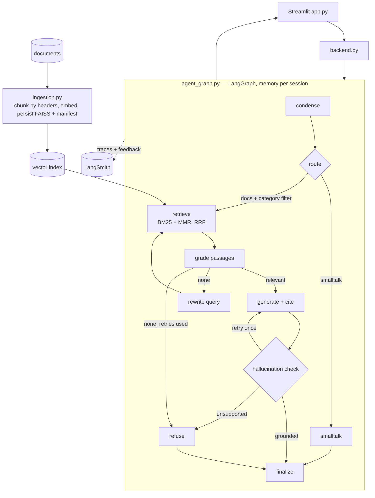

# ⭐ Capstone — Northwind Internal Docs Assistant

**Scaffolding:** 🔴 Spec-only. You architect and build the whole thing, reusing
everything from Tasks 1–8. A thin app skeleton is provided so you don't burn time
on plumbing; the RAG brain is yours to build.
**Time budget:** ~2 days (the back half of Week 1). Demo on Friday.

---

## The brief
Build an **internal knowledge assistant** for a company (our fictional *Northwind
Robotics*, using the docs in `../data/`). An employee should be able to ask
natural-language questions about HR policies, IT procedures, and product specs and
get a **correct, grounded, cited** answer — through a simple chat UI.

This is the real job of an applied RAG engineer: not a notebook, but a small
*product* that is retrieval-quality-aware, evaluated, traceable, and honest about
what it doesn't know.

## Required capabilities (the "must-haves")
1. **Ingestion pipeline** — load the corpus, chunk it sensibly, embed it, and
   persist a vector index. Re-running the app must not re-embed from scratch.
   Support adding a new document without a full rebuild if feasible.
2. **Agentic retrieval + answering** — reuse your **LangGraph** graph from Task 8
   (routing, doc grading, query rewrite, hallucination check). The assistant must
   refuse (not hallucinate) when the answer isn't in the docs.
3. **Conversational memory** — multi-turn follow-ups work (Task 5), isolated per
   user session.
4. **Citations** — every answer shows which source file(s)/section it used.
5. **Chat UI** — a Streamlit app (`app.py`) with a chat box, streaming answers,
   visible sources, and a session reset button.
6. **Evaluation** — a LangSmith eval suite (extend Task 7's dataset to ≥20
   examples) reporting correctness + groundedness. Commit your latest scores in
   `EVAL_RESULTS.md`.
7. **Tracing** — LangSmith tracing on, so a reviewer can inspect any answer's path.

## Nice-to-haves (pick based on time / ambition)
- **Metadata filtering** (e.g. restrict to `source = it_faq.md` when the user asks
  an IT question) driven by the router.
- **Access control** demo: tag some docs "HR-only" and filter by a fake user role.
- **Streaming tokens** in the UI.
- **Feedback capture**: 👍/👎 buttons that log to LangSmith.
- **Answer caching** for repeated questions.
- **Dockerfile** so the app runs with one command.

## Architecture you should end up with
```
                 ┌─────────────┐
   documents ───▶│  Ingestion  │──▶ vector index (persisted)
                 └─────────────┘            │
                                            ▼
 user ──▶ Streamlit UI ──▶ LangGraph agentic RAG ──▶ grounded, cited answer
              ▲   │              │  (route → retrieve → grade → rewrite?
              │   │              │   → generate → hallucination-check)
              │   └── session memory        │
              └──────────── answer + sources ┘
                                            │
                              LangSmith  ◀──┘  (tracing + evaluation)
```

## Deliverables (what you hand in Friday)
1. Working `app.py` (Streamlit) + supporting modules.
2. `README` in this folder updated with **how to run it** (commands).
3. `EVAL_RESULTS.md` — your correctness/groundedness scores + a short note on the
   biggest failure mode and how you'd fix it next.
4. A **5-minute demo**: show a correct answer with citation, a refused
   out-of-scope question, and a multi-turn follow-up. Walk through one LangSmith
   trace.
5. A short architecture diagram (Mermaid is fine).

## How you'll be graded
Your mentor holds the full rubric. Headline weighting:
correctness & grounding (30%), retrieval quality (20%), agentic design (20%),
evaluation rigor (15%), code quality & UX (15%).

## Getting started
- Read `app_skeleton.py` — it has the Streamlit plumbing wired and clearly marked
  `# TODO` spots where your RAG backend plugs in. Copy it to `app.py` to begin.
- Reuse aggressively: your Task 8 `graph.py`, Task 6 retriever, Task 5 memory,
  Task 7 eval harness. The capstone is *integration*, not reinvention.
- Start with the thinnest end-to-end slice (ingest → ask → answer in the UI), get
  it working, *then* layer in grading, memory, and evaluation.

---

## How to run it
From the Week-1 repo root (venv active):

```bash
pip install -r capstone_internal_docs_assistant/requirements.txt
cp capstone_internal_docs_assistant/.env.example capstone_internal_docs_assistant/.env   # add LANGSMITH_API_KEY
ollama pull qwen3.5:4b                       # if you haven't already

python capstone_internal_docs_assistant/ingestion.py          # optional: build the index now (prints which data folder it found)
streamlit run capstone_internal_docs_assistant/app.py         # chat UI
```

The first start embeds the documents and saves the index to `.index/`; later starts load it
and only embed files that are new or changed. Drop a `.md`/`.txt` into the data folder, or use
**Add a document** in the sidebar, and only that file is indexed.

Data folder: your `../data/` (subfolders are fine; `.md` and `.txt` files) if it has any, otherwise
the bundled `sample_data/` stand-in corpus. Override with `DATA_DIR`. The repo-level `.env` is loaded
automatically, so your existing keys are reused; `.env.example` here only lists the capstone's extra options.

```bash
pytest capstone_internal_docs_assistant/tests -q                                   # offline wiring tests
python capstone_internal_docs_assistant/eval/run_eval.py --note "baseline"          # LangSmith experiment
python capstone_internal_docs_assistant/eval/run_eval.py --retriever mmr --note "mmr only"
python capstone_internal_docs_assistant/eval/run_eval.py --local                    # no LangSmith
```

fish shell: `source .venv/bin/activate.fish`; everything else is identical.

## Architecture


| Requirement | Where |
|---|---|
| Ingestion, persisted, incremental | `ingestion.py` (manifest of file hashes + chunk ids) |
| Agentic RAG, refuses out-of-scope | `agent_graph.py` (grade → rewrite → refuse; hallucination check) |
| Memory isolated per session | LangGraph `MemorySaver`, `thread_id = session_id` |
| Citations | answer cites `[file.md]`; UI shows `file › section` |
| Chat UI, sources, reset | `app.py` (agent steps stream live; answer streams after verification) |
| Evaluation | `eval/run_eval.py` + `eval/dataset.json` (26 examples) → `EVAL_RESULTS.md` |
| Tracing | set `LANGSMITH_*`; every run is named and tagged with the session id |
| Nice-to-haves done | router-driven metadata filtering, hybrid retrieval, 👍/👎 → LangSmith feedback, add-document upload |
| Not done | access control, answer caching, Dockerfile |

## Things to know
- **Eval dataset:** `eval/dataset.json` has 30 hand-written examples (25 answerable, 5 out-of-scope)
  for the four files in `data/`. If you change the documents, edit it; if you edit it after a LangSmith
  run, delete the `northwind-capstone` dataset in LangSmith so it is re-uploaded.
  `eval/generate_dataset.py` can draft questions for a *different* corpus, and
  `eval/dataset_sample.json` belongs to the bundled `sample_data/` stand-in.
- **Categories:** the handbook and `hr_policies.md` are one `hr` category, because PTO/leave sit in the
  handbook while expenses/reviews sit in the HR policies.
- **Judge = your local 4B model by default**, which is a noisy grader. Use `--judge-model` or an
  OpenAI/Groq judge for numbers you'd defend in the demo.
- The answer is streamed only after the hallucination check passes, so users never see a draft that
  later gets retracted. Tradeoff: no token-by-token streaming straight from the model.
- `EVAL_RESULTS.md` is filled by `run_eval.py`; the failure analysis section is yours to write
  from `eval/last_run.json`.
- `app_skeleton.py` is left as provided; `app.py` is the finished version (both TODOs filled in).
